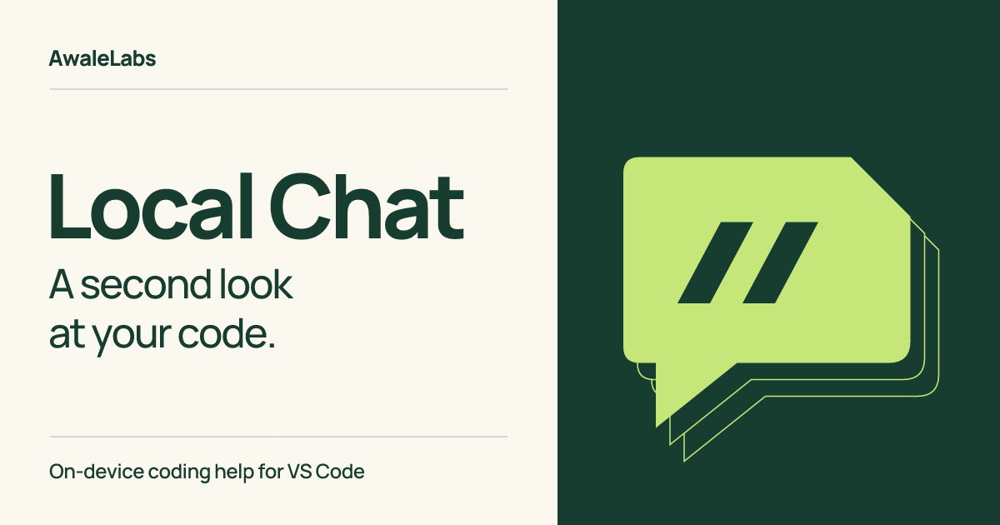

# Local Chat by AwaleLabs

## Name and voice

Use **Local Chat by AwaleLabs** in listings and on first mention. Use **Local Chat** in the sidebar, command titles, and subsequent mentions. “Apple Foundation Models” names the framework. **Apple On-Device** is the model name users see in compatible VS Code clients.

**A second look at your code.** The line describes the moment a developer pauses on a function or a diff. Lead with what they can select, ask, or review. Name the artifact they get back. For example, “Stage your changes and draft a commit subject” tells the reader both where to start and what to expect.

## Ready-to-use copy

| Placement | Copy |
| --- | --- |
| Marketplace title | Local Chat by AwaleLabs |
| Marketplace summary | Explain selected code, draft doc comments, and turn staged changes into a commit subject with Apple’s on-device model for Mac. |
| AwaleLabs Apps card | A second look at your code. Ask about a selection, draft a doc comment, or find the words for a commit, right in VS Code. |
| Product page intro | Select a function you want to understand and open Local Chat. Ask a follow-up, draft a comment, or stage your changes for a suggested commit subject. You review the result. Apple’s Foundation Models framework runs the conversation on your Mac. |
| Install link label | Install for VS Code |
| Requirements line | Requires VS Code 1.104 or later and an Apple Intelligence–eligible Mac running macOS 26 or later. Enable Apple Intelligence and finish the model download to use the sidebar offline. |

## Visual identity

The mark puts the two strokes of a code comment inside a speech bubble. The clipped corner and pointed tail give the silhouette a direction even at Activity Bar scale. The large cover repeats the outline like a stack of review notes. Use the single silhouette for icons.

| Color | Hex | Use |
| --- | --- | --- |
| Forest | `#173C30` | Wordmark, headlines, icon tile, and Marketplace banner |
| Paper | `#FBF8EF` | Editorial backgrounds and light text on forest |
| Lime | `#C5E779` | Extension accent for the mark on forest |

Set promotional text in **Manrope**. Use a bold weight for the name and medium for the headline. The supplied wordmark and cover have outlined lettering so they render consistently without a font install. The sidebar uses the reader’s VS Code theme and UI font.

## Artwork

| Asset | Where to use it |
| --- | --- |
| [Wordmark · SVG](wordmark.svg) | Product pages and press materials on a light background. Leave at least one slash-width clear on each side. |
| [Icon master · SVG](icon.svg) · [Marketplace icon · 256 px PNG](../../media/icon.png) | Square app tiles and the extension listing. The master includes its own padding. |
| [Monochrome mark · SVG](../../media/chat/activity.svg) | The VS Code Activity Bar. The host supplies the color. |
| [Share card · 1200 × 630 PNG](cover.png) · [Vector artwork · SVG](cover.svg) | Social previews or a launch announcement. Use the icon for square crops. |

Suggested share-card alt text: “Local Chat by AwaleLabs. A second look at your code. A speech bubble holds two code-comment slashes.”

## Research basis

Reviewed on 18 November 2026 using Firecrawl. The AwaleLabs site supplied Manrope, forest, and paper. Lime and the double-slash bubble were created for this extension. [AwaleLabs](https://awalelabs.cloud/)

The studio’s product page used “Apple Local Chat for VS Code” and described the selection and staged-diff workflows. The Marketplace listing used “Apple Foundation Models.” The new name keeps “Local Chat” and identifies the studio. Existing installs keep the extension ID `sagarawale.apple-foundation-vscode`. [Product page](https://awalelabs.cloud/apps/apple-local-chat-for-vs-code/) · [Marketplace listing](https://marketplace.visualstudio.com/items?itemName=sagarawale.apple-foundation-vscode)
