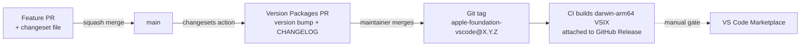

# Release process

Releases are automated with [Changesets](https://github.com/changesets/changesets) and GitHub
Actions. Rationale: [ADR-0005](adr/0005-release-automation.md).

## How a change becomes a release



1. **Contributor** adds a changeset (`pnpm changeset`) in the feature PR describing the semver
   impact (`patch`/`minor`/`major`) and user-facing notes.
2. On merge to `main`, the release workflow runs `pnpm run verify`, then the Changesets action
   creates or updates a **"Version Packages" PR** that accumulates pending changesets, bumps
   `package.json`, and rewrites `CHANGELOG.md`.
3. **A maintainer merges the Version Packages PR** — this is the release decision. The workflow
   tags `apple-foundation-vscode@X.Y.Z`, packages the VSIX, and uploads it to the GitHub Release.
4. **Marketplace publish** is currently a manual step (commented out in
   `.github/workflows/release.yml`) until the publisher account and `VSCE_PAT` secret are
   provisioned. To enable: create the publisher, add the secret, uncomment the step.

## Versioning policy

- Semver from the user's perspective: settings, commands, and visible behavior are the API.
- Pre-1.0, breaking changes bump minor (standard semver 0.x rules); we still write migration
  notes in the changeset.

## Hotfixes

Same pipeline — a `fix/` branch with a `patch` changeset, merged twice (feature PR, then Version
Packages PR). No separate hotfix track; keeping one path keeps it reliable.

## Signing and notarizing public VSIX releases (macOS)

Local development builds and unsigned CI dry runs ad-hoc sign `dist/apple-local-helper` (`codesign --force --sign - --timestamp=none`). For public `.vsix` releases distributed via GitHub Releases or the VS Code Marketplace, sign the helper with a Developer ID Application certificate and notarize it so macOS Gatekeeper does not block execution on quarantined downloads:

1. Build and sign with Hardened Runtime and a secure timestamp by setting `APPLE_DEVELOPER_ID` (the certificate name or SHA-1 identity in your login keychain):

   ```sh
   APPLE_DEVELOPER_ID="Developer ID Application: Your Name (TEAMID)" pnpm run build
   ```

2. Archive the signed binary and submit it to Apple's notarization service via `xcrun notarytool` (using a stored keychain profile created with `xcrun notarytool store-credentials`):

   ```sh
   ditto -c -k --keepParent dist/apple-local-helper /tmp/apple-local-helper.zip
   xcrun notarytool submit /tmp/apple-local-helper.zip --keychain-profile "AC_NOTARY" --wait
   rm -f /tmp/apple-local-helper.zip
   ```

   Note: `xcrun stapler` only supports app bundles, disk images, and installer packages—not standalone Mach-O executables—so macOS verifies the notarization ticket online via Gatekeeper once `notarytool submit --wait` returns `Accepted`.

3. Verify the signature before packaging the VSIX:

   ```sh
   codesign --verify --strict --verbose=2 dist/apple-local-helper
   pnpm run package
   ```

## Release checklist (maintainer)

- [ ] CI green on `main`
- [ ] Manual test checklist from [testing-strategy.md](testing-strategy.md) run on real hardware
- [ ] Version Packages PR changelog reads like something a user would want to read
- [ ] For public VSIX releases: `dist/apple-local-helper` signed with `APPLE_DEVELOPER_ID` and notarized via `xcrun notarytool`
- [ ] After merge: GitHub Release has the VSIX attached and installs cleanly
      (`code --install-extension`)
